# HAPPY BIRTHDAY V.2 – "Face Scan" prank page

An interactive birthday surprise website with a green hacker theme.

It asks a couple of questions, pretends to take over the visitor's phone,
runs a fake face scan and a fake hack, then reveals a Happy Birthday screen
with a cake, music and falling code.

**Live demo:** https://abnalshamtech.github.io/HAPPY-BIRTHDAY-V.2/

> **Note:** this page does not collect, send or store any data, and it never
> turns on the camera – the face scan is only an animation.
> It's only a small, harmless joke to surprise your friends.

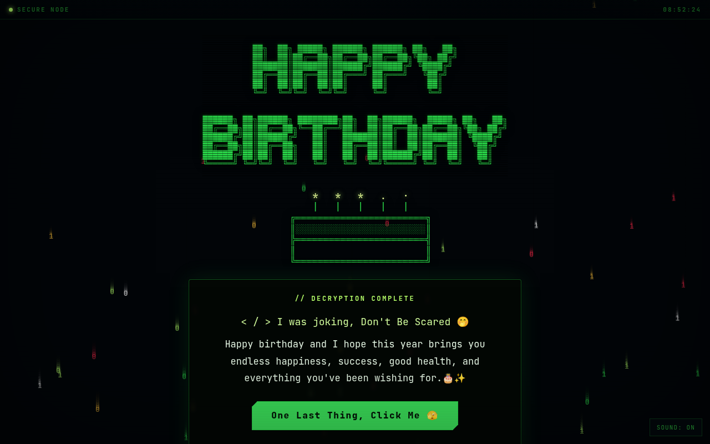

## How it works

**1. The question:** "Do You Trust Me?" with a blinking "!" on top.

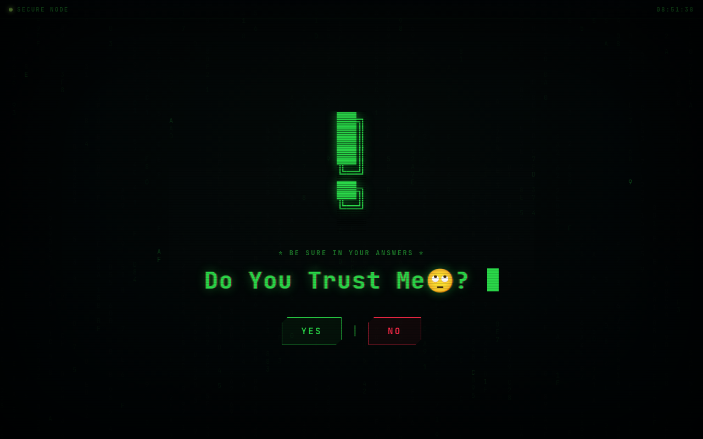

**2. Saying no:** a popup appears, then the "NO" button glitches away so only "YES" is left.

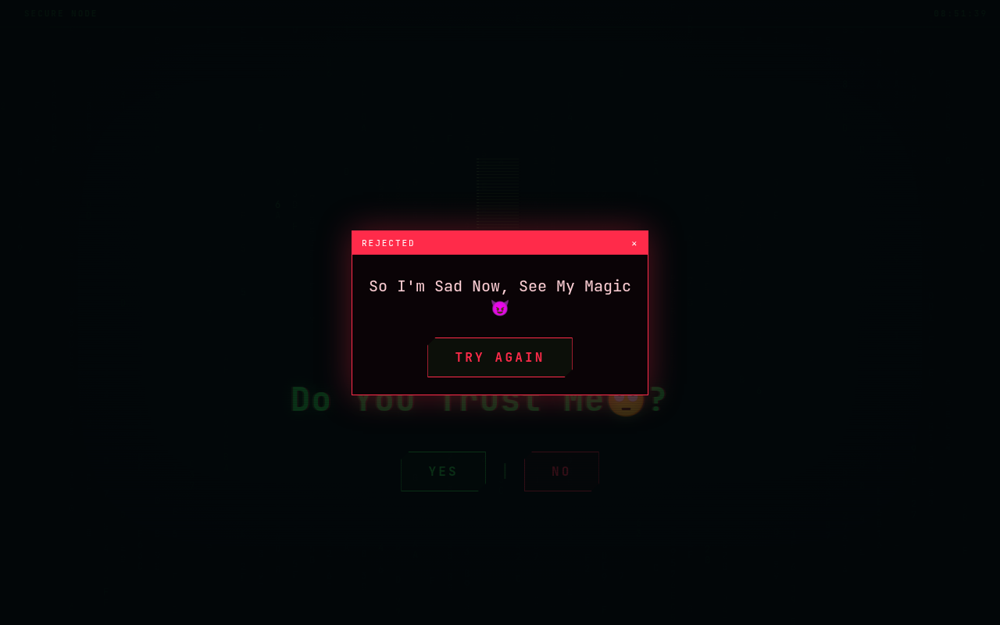

**3. Access granted:** a fake progress bar "links" to the phone.

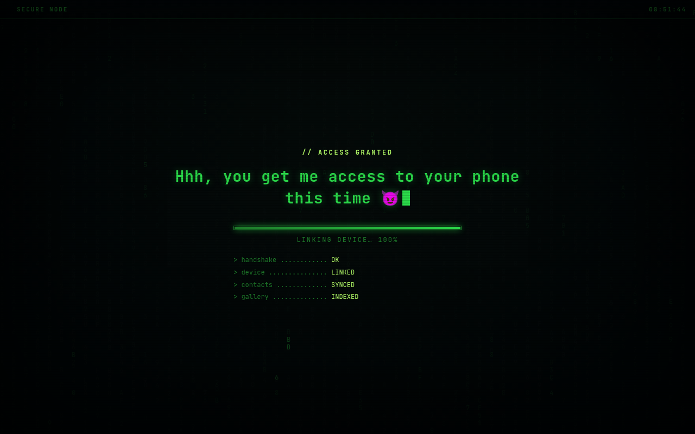

**4. The warning:** "This time is not like before… the system is stronger" and a hooded figure made of moving text appears.

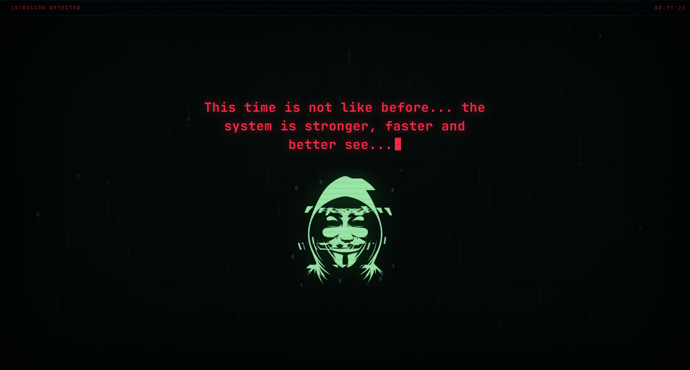

**5. The camera:** "Can I Use Your Camera?" "NO" also disappears after the first click.

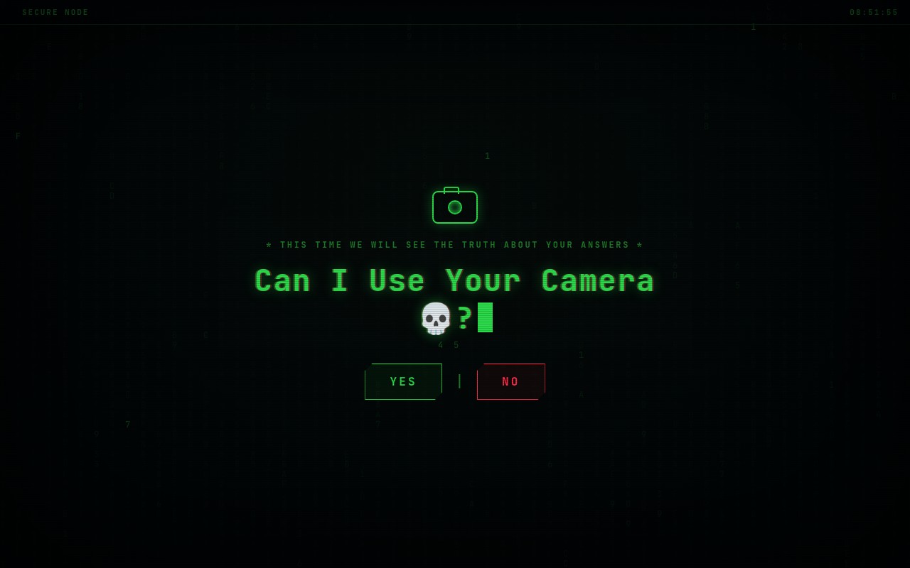

**6. The face scan:** dots, a 3D face mesh, then *FACE MATCH: 99%* and *TARGET LOCKED*. Nothing real is scanned.

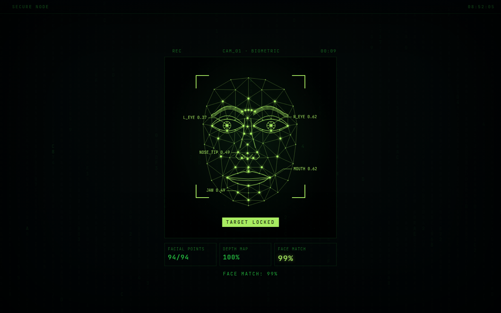

**7. The identity card:** shows the name and today's date, then *INFORMATION DOES NOT MATCH*.

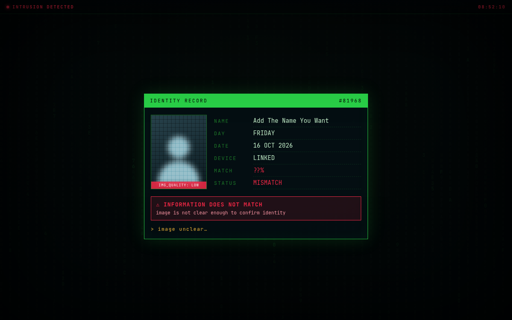

**8. The fake hack:** falling code, static, the hooded figure and a progress bar.

**9. The reveal:** Happy Birthday with ASCII art, a flickering cake, music and the birthday message.

## On mobile

  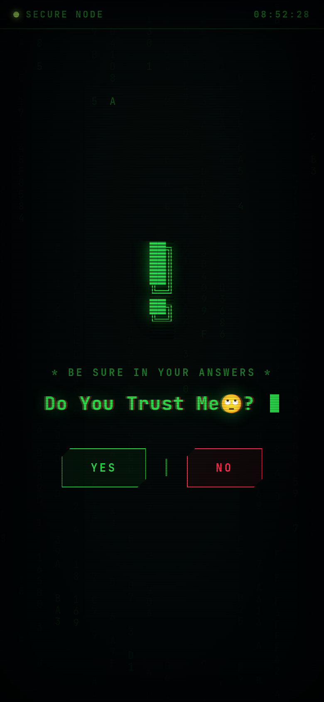
  &nbsp;&nbsp;
  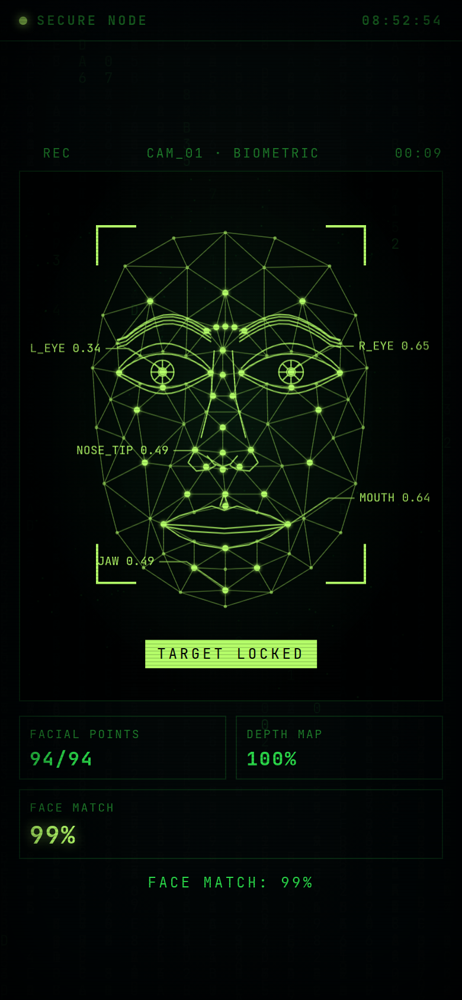
  &nbsp;&nbsp;
  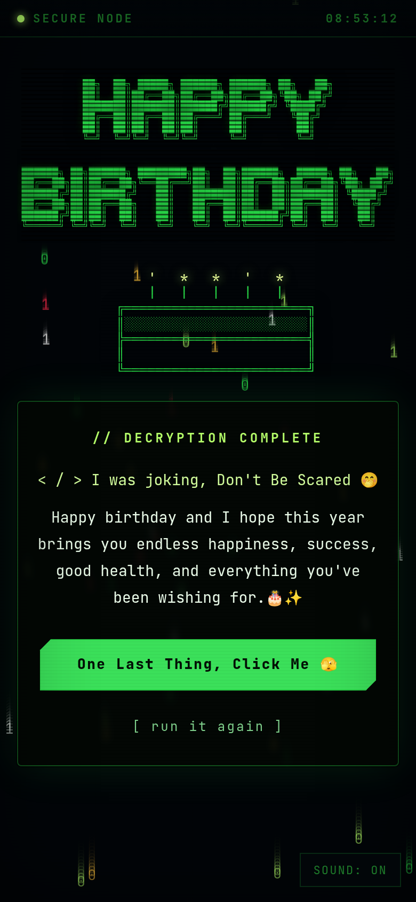

## Change the texts, name or phone

Open `index.html` and scroll to the **CONFIG** block at the bottom
(marked **EDIT HERE**). You can change the questions, the messages,
the name on the identity card, the birthday wish and the phone number there.

Don't forget to put your own number in `"phone": "+0000000000"`
(country code + your number).

To use your own mask picture instead of the hooded figure, put a PNG in the
folder and write its name in `"maskImage"`, e.g. `"maskImage": "mask.png"`.

## Files

| File         | What it is                                     |
|--------------|------------------------------------------------|
| `index.html` | The page, plus the CONFIG block                |
| `style.css`  | All the styling                                |
| `script.js`  | All the behaviour                              |
| `_headers`   | Security headers (Netlify / Cloudflare Pages)  |
| `Images/`    | Screenshots used in this README                |

## Run it

No build step. Open `index.html` in a browser, or host the folder on
GitHub Pages, Netlify or Cloudflare Pages.
